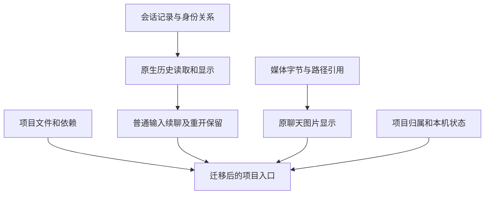

# 一次 Windows Codex 大型会话迁移复盘

案例发生于 2026 年 10 月 16 日至 19 日；整理于 2026 年 11 月 17 日。

我们把一个电影制作项目从个人电脑迁到工位电脑，希望保留原会话 ID、历史、图片、子会话关系及项目文件，同时保住目标用户原有的会话和项目。最终在目标的日常 Windows 用户中完成接入、人工续聊、项目关联和已核实可恢复的媒体文件回填，并让目标原会话确认收到最终交接。

这是一次有明确版本边界的实测案例。目标桌面应用当时为 Windows Store 版本 `26.1013.3656.0`。以下做法不构成官方迁移接口，也不代表当前版本仍使用相同文件结构。原始代码、日志和会话均未随本文公开；机器名、用户名、会话 ID 和项目路径已泛化。

后续检索确认：官方跨机 Handoff 早于本案例，社区也已有相近实践。当时没有找到符合全部要求的入口，不等于官方没有迁移相关能力。读者请先看[官方能力与相关工作](RELATED_WORK.zh-CN.md)，再判断本案哪些步骤适用于自己。

## 1 为什么这次搬家比较难

源电脑系统盘空间紧张，项目已有大量制作文件和长历史。目标电脑已经在用 Codex，旧会话不能被覆盖。两边登录相同账号，在当时的实测环境中，并没有因此自动出现源电脑的本地会话。

用户的目标很具体：继续同一条聊天，在目标日常 Windows 用户里工作，保留已有项目。独立 Windows 测试用户只用于演练，不应悄悄变成最终工作位置。

项目盘通过物理方式送到目标电脑；用户决定让它持续连接，计划留到项目完成。用户把它称为“卡车拉硬盘”：带宽很高，运输很慢，丢包就是百分之百。我们用盘上的交流目录传递小型诊断包和说明，而不是反复通过聊天传几十 GB 数据。

| 对象 | 当时核验的规模 | 统计口径 |
| --- | ---: | --- |
| 冻结包 | 19,872 个文件，40,037,122,060 字节，约 37.29 GiB | 项目、父目录材料、会话与外部媒体合计 |
| 会话族 | 69 个，18,648,868,090 字节 | 1 个主会话与 68 个直接子会话 |
| 主会话冻结前缀 | 3,650,961,595 字节 | 后续恢复会追加设置或消息，不要求整文件哈希永远不变 |
| 原项目文件 | 18,737 个 | 另有父目录 5 个文件；文件数不能与目录数混用 |
| 目标原有数据 | 329 个会话、8 个项目、120 条父子关系 | 采用最终冷基线，早期在线盘点曾为 324 个会话 |
| 最终媒体回填 | 1,066 个文件 | 原批次 1,061 个，加后来找到的 5 个 |
| 最终保留的缺失引用 | 349 条 | 是历史引用，不等于 349 张制作素材丢失 |

这些数据来自阶段记录和目标端回报。最终图片界面验收由用户定位原聊天完成；文件核验是全量，界面观察是抽样及五张补图逐项确认。

## 2 先把正在做的工作停在可继续的位置

搬家前先完成已授权的最后一轮工作，保存暂停断点，明确整场验收与部分镜组验收的差别，以及对白、听审和最终混音仍未完成。

迁移期间反复强调“读取断点不等于执行其中的开工指令”。恢复历史会让旧指令重新出现在上下文中，因此当前的暂停状态和本轮授权要明确。迁移验收始终没有自动变成正式制作。

## 3 用小样本分离变量

第一个样本约 80 KiB，是一个子智能体会话。文件哈希正确，线程元数据能被发现，但历史无法正常加载。日志显示子会话受父会话恢复条件限制；目标也没有该样本的分页历史投影。两个观察同时成立，但我们不能据此证明“缺父会话导致投影缺失”。

第二个样本改为无父会话依赖的普通主会话，只有两轮纯文本。它成功保留原 ID、原消息与 turn/item ID，恢复历史并通过正常退出重开。

接着发生了一次试验设计错误：通过跨聊天发送工具投递消息，却要求新增普通 `userMessage`。实际落盘为外部投递项 `functionCallOutput`，模型已经正确响应并复述历史。这不能判成迁移损坏。改由用户在样本输入框手动发送一次后，普通用户回合、历史复述和重开持久性均通过。

经验是：先用普通主会话验证最小路径，再逐项加入父子关系、图片和文件工具。发送渠道也必须和验收条件一致。

## 4 冻结会话族和依赖，而非只复制聊天文件

我们盘点了主会话、子会话、项目文件、外部图片及已知缺失引用，正常关闭源 Codex 后制作冻结副本。清单保存大小、哈希、相对路径及身份关系。目标先验证整包，再验证实际项目盘的卷身份和项目内容。

仅有盘符不足以认定是同一块盘；仅有文件名也不足以证明是一张相同图片。冻结包记录的是一个时间点，后续找回文件时另加补充记录，不把原始缺失清单改成从未缺失。

我们的层次划分是：

这不是 Codex 官方存储架构图，而是本案例的验收拆分。新的生图、图片编辑、编码、审片及音频生产链路没有在此次迁移中完成生产验收。

## 5 目标已有数据必须作为一等验收对象

我们先在独立 Windows 用户演练真实副本，再进入目标日常用户。正式接入采用冷备份与逐文件无覆盖新增，保留目标自己的数据库及项目记录，没有用源 `.codex` 整体覆盖目标。

同 ID 检查覆盖状态库和相关会话文件范围。测试用户已有一个与冻结包字节完全一致的样本，按明确计划保留；这不意味着遇到同 ID 都可以跳过。若内容已经各自增长，它就是需要人工判断的分支冲突。

接入后，目标原有会话、项目、父子关系及指定旧聊天被纳入验收。迁入内容成功而旧数据受损，也不能算成功。

## 6 Windows 冷备份的几次教训

为证明可恢复，我们除了校验备份，还把备份恢复到新的隔离目录。这暴露了普通文件复制掩盖的问题。

| 现象 | 查明的情况 | 修正与适用边界 |
| --- | --- | --- |
| 内核扩展属性写入调用成功，回读却没有 | `$KERNEL.PURGE.ESBCACHE` 不能按普通 EA 的成功返回值判断已恢复 | 保存原始证据，只为精确识别的对象记录不回放限制；不声称完整复制所有 NTFS 属性 |
| 准备时只有 4 个 EA 对象，冷运行却遇到更多 | 两次冷盘点均观察到 7 个非空 EA 路径 | 以实际冷清单为准，修订精确范围；不能扩大为忽略任意 EA |
| 隔离恢复报 WinError 1307 | 某些原 owner 不可由当时令牌直接赋回 | 先做隔离 owner 恢复试验，再验证完整恢复树；没有因此让 Codex 长期管理员运行 |
| 69 个文件已写完，末阶段仍报目录元数据变化 | 新增文件使部分 NTFS 祖先目录的大小与时间变化，被过严守卫误判 | 保留现场，做逐字段只读诊断，核对文件内容和对象范围；不重跑已经写完的接入 |
| `node_modules` 是绝对 junction | 遍历链接可能跑出预定备份范围 | 在本案中记录并验证重解析信息，不把链接目标误当成本树普通子目录 |

目录误报中的 `ea.source_identity.size` 是对象身份观测里的大小字段，不代表 EA 内容改变。微软也明确指出，用户态设置 Kernel EA 可以返回成功但实际不修改；这支持我们必须回读的判断，不证明本案具体缓存的自动重建行为。[Microsoft Kernel Extended Attributes](https://learn.microsoft.com/en-us/windows-hardware/drivers/ifs/kernel-extended-attributes)

这些是本案恢复要求带来的工程工作，不应宣传成每个人迁移都必须走一遍的流程。可复用的原则是“先定义需要恢复什么，再证明这一层能恢复”。若只承诺保存文档和历史，不应同时声称逐位保全系统缓存；若需要更强的系统恢复保证，应使用适合的备份方案。本案也没有宣称审计 SACL、硬链接拓扑或文件系统分配布局全部等价。

我们也要承认：反复的全量验证、预设数据库字段必变等做法增加了时间成本。有限检查通过且没有新风险时，应继续推进，不把检查次数当作可靠性的替代品。

## 7 复制成功与原生恢复成功分开验收

首次侧栏没有会话、读取状态为 `notLoaded`，都不足以独立证明历史丢失。通过明确 ID 原生打开后，主会话成功加载。恢复后文件追加设置记录，因此我们核验冻结前缀哈希，并解释新增后缀，而非要求当前整文件哈希等于冻结值。

目标主会话原有 48 个回合中有冻结前就存在的未完成或失败状态。应把这些旧状态与当前 `idle` 及最近回合结果区分，不把历史痕迹误认为此次恢复重新启动了工作。

用户再从输入框发送一条严格限定的只读任务，实际读取暂停断点和一张项目原图。新回合完成、原消息身份保留、原文件未变，随后正常退出重开验证持久性。49 回合是当时的基线，不是以后不可增长的上限。

测试环境曾显示代表性子会话历史；最终目标核验了身份和父关系，部分原生历史抽查仍受工具单轮大小限制。68 个子会话没有逐一恢复执行。

## 8 项目归属和图片必须单独修复

### 项目归属

会话能读取项目目录，不等于它已经出现在对应侧栏项目下。我们通过原生功能登记已有目录，将原会话加入项目，再核验原生回读、持久化关联和界面。

本版原生关联已成功时，SQLite 的旧 `project_id` 仍为空。不同存储里的项目 ID 也不属于同一命名空间。我们保留这个差异，没有为了让某一条 SQL 查询“看起来正确”去手工改库。

### 图片恢复

原聊天中的上传图和生成图仍引用源 Windows 用户下的绝对路径。部分图片字节在项目盘或会话里仍存在，但原气泡仍加载失败。一次独立文件预览成功，只证明该副本可看，不能替代原气泡验收。

本版抽查实现中，生成图优先使用旧保存路径，失败后没有在该选择链自动使用内嵌数据。这是该版本的局部实现证据，不是跨版本保证。

我们没有全局改写历史记录，而是对经过核验的图片，在目标建立精确旧路径的同字节兼容副本。先恢复一张上传图 A，再恢复一张生成图 B；普通目标用户能读、哈希正确、原缩略图和大图正常后，才扩展到固定清单。

**这是案例中的权宜办法，不是通用首选。** 它涉及源用户名路径的占用、目录权限、清理策略及长期维护。不能据本文直接创建任意 `C:\Users\<source-user>` 树，更不能覆盖真实用户目录、建立宽泛链接或整树删除。原始脚本绑定了本机对象身份和精确范围，不适合作为一键工具公开。

原批次共恢复 1,061 个媒体文件。之后，四张缺图由历史回收记录解释了旧 C 副本被删除的原因；另有一张也找到了同哈希的项目盘副本。五张均未进入原冻结包的外部媒体集合，后来按逐项证据补回。没有把第五张的缺失原因也归到同一次清理。

由此得到两个不同统计：整个回填集合为 1,066 个文件；主会话的 103 个生成项中，98 个原批次覆盖、5 个补回。它们不能相互替代。原 354 条缺失引用减去这 5 条，仍保留 349 条未解决。

## 9 交接的是继续工作的分支

两台电脑即使会话 ID 相同，冻结后也会分别追加消息。原 ID 保留不代表自动同步，也不能把两份 JSONL 拼接成可信的统一历史。

最终明确目标日常用户里的会话为后续工作入口。源与测试分支保留作参考；新增决定通过普通交接消息传达，不再用后来增长的源记录覆盖目标。目标原会话只读最终说明并确认接收，迁移到此收尾，正式制作仍等待用户复工指令。

## 10 可以复用的经验

1. 先保留目标已有数据，再谈搬入多少新数据。
2. 先普通主会话小试，再加入真实规模、子会话和媒体。
3. 分别验证文件、身份关系、历史、输入、项目归属、媒体显示和实际依赖。
4. 用原始前缀与可解释增量检查可追加文件；用对象身份与哈希检查回填文件。
5. 将已有缺失、此次故障和工具限制分开记录。
6. 写入后报错先定位提交边界，不自动重跑、不删除运行标记掩盖现场。
7. 测试的发送方式、打开方式必须与真实用途一致。
8. 让报告解释可观察结果；也允许证据指出测试本身设计错了。
9. 预先定义足够的验收标准，达到后结束迁移。
10. 明确哪一份会话继续工作，并把最后的新决定交到那一份里。

这次经验的价值，是证明了一个复杂场景可以被拆解、验证和收尾；它没有证明一个固定复制命令能适用于所有 Codex 版本与电脑。
